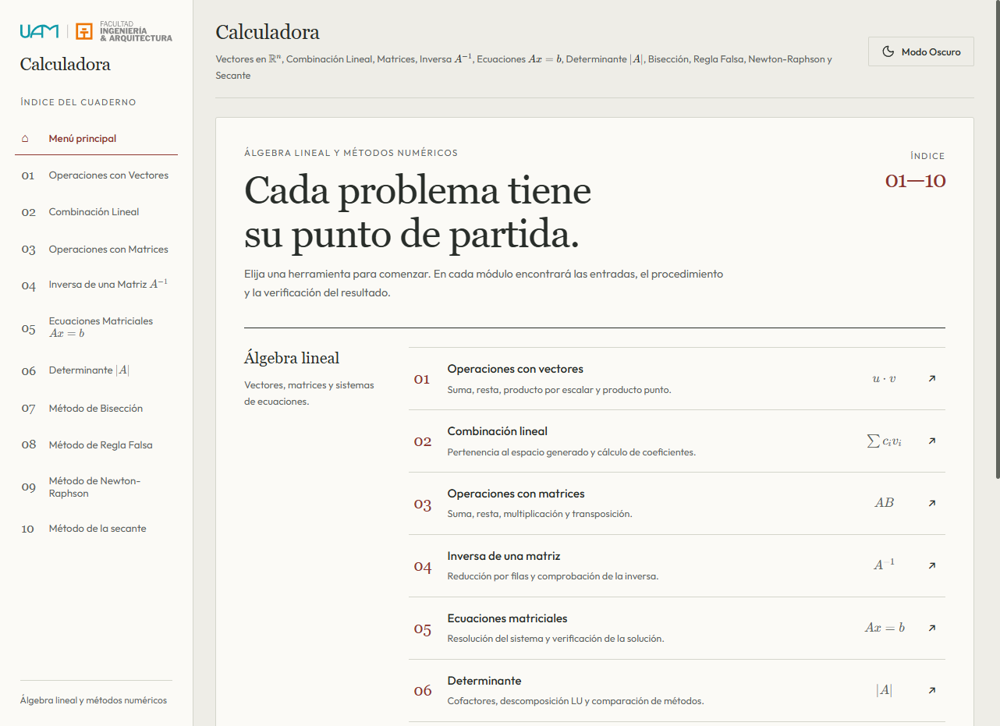

# Calculadora de Álgebra Lineal

Calculadora educativa de **álgebra lineal y métodos numéricos** con procedimientos
paso a paso, fórmulas matemáticas, gráficas y comprobación de resultados.
La misma interfaz funciona en el navegador y en una aplicación de escritorio.

**Versión candidata: `1.0.0-rc.1`.** Se publica como prerelease para recibir
comentarios antes de declarar la primera versión estable.

[Descargar para Windows](https://github.com/wigar03/Calculadora-AlgebraLineal/releases/tag/v1.0.0-rc.1)
· [Guía matemática](docs/guia-matematica.md)
· [Notas de versión](CHANGELOG.md)
· [Reportar un problema](https://github.com/wigar03/Calculadora-AlgebraLineal/issues)
· [Code signing policy](docs/firma-codigo.md)



## Qué puedes calcular

| Área | Herramientas |
|---|---|
| Vectores | Suma, resta, multiplicación por escalar y producto punto en dimensión variable. |
| Combinación lineal | Pertenencia al espacio generado y clasificación mediante rangos. |
| Matrices | Suma, resta, escalar, producto y transpuesta. |
| Inversa | Gauss y Gauss-Jordan, detección de singularidad y verificación. |
| Sistemas `Ax = b` | Solución única, infinitas soluciones o incompatibilidad. |
| Determinantes | Cofactores y descomposición LU, con comparación de eficiencia. |
| Bisección y regla falsa | Intervalos, validaciones, errores e historial de iteraciones. |
| Newton-Raphson | Derivada simbólica, punto inicial manual, tangentes y criterios de parada. |
| Secante | Dos puntos manuales, rectas secantes e historial de aproximaciones. |

Los módulos de álgebra lineal trabajan con fracciones exactas sobre entradas
racionales. Los métodos numéricos trabajan en punto flotante y muestran errores
y residuo. Las gráficas son orientativas y no demuestran continuidad ni convergencia.

## Instalar en Windows

1. Descarga `CalculadoraAlgebraLineal-1.0.0-rc.1-windows-x64-setup.exe` desde el release.
2. Ejecuta el instalador y sigue los pasos en español. La instalación es por usuario.
3. Abre **Calculadora de Álgebra Lineal** desde el menú Inicio.

No necesitas instalar Python ni Node.js. La versión de escritorio está dirigida
a Windows 10/11 x64 y utiliza Microsoft Edge WebView2 Runtime. Si falta, el setup
intentará instalarlo y necesitará internet para esa descarga inicial.
Después, los cálculos, las fórmulas y las fuentes funcionan sin conexión.

También se ofrece un ZIP **portable**: extrae toda la carpeta y ejecuta
`CalculadoraAlgebraLineal.exe`. Requiere WebView2 ya instalado; conserva `_internal`
junto al ejecutable. Los archivos `SHA256SUMS.txt` permiten comprobar las descargas.

Esta candidata no cuenta con firma digital del editor. Windows puede mostrar una
advertencia de aplicación no reconocida. Descarga los archivos del release oficial.
Puedes desinstalarla desde **Configuración → Aplicaciones** de Windows.

## Usar en el navegador desde el código

Requiere Python 3.12, la versión utilizada para validar esta candidata.
El modo web local no necesita paquetes de terceros de Python.

```bash
python main.py
python main.py --port 8081
python main.py --no-browser
python main.py --version
```

El programa abre `http://127.0.0.1:8080` o un puerto disponible. Para detenerlo,
pulsa `Ctrl+C` en la terminal. La interfaz y el motor se ejecutan en tu computadora.
No es necesario publicar ni subir tus cálculos a un servicio externo.

El repositorio todavía no ofrece un servicio web público alojado. Para ofrecerlo
se necesita desplegar también la API Python y preparar el servidor para ese uso;
publicar únicamente los archivos estáticos no ejecuta los cálculos.

## Desarrollo y pruebas

```bash
python -m unittest discover tests -v
node --test tests/test_biseccion_ui.cjs tests/test_formula_keyboard.cjs tests/test_regla_falsa_ui.cjs tests/test_newton_raphson_ui.cjs tests/test_secante_ui.cjs
```

Node.js se utiliza únicamente para las pruebas de JavaScript.
Para abrir o compilar la aplicación de escritorio, consulta
[la guía de distribución](docs/distribucion.md).

## Alcance de esta candidata

- Diez módulos, tema claro/oscuro y navegación adaptable al tamaño de pantalla.
- Escritorio Windows y navegador local con el mismo motor de cálculo.
- Recursos matemáticos incluidos para uso sin conexión.
- No incluye todavía historial persistente de cálculos, exportación de informes,
  sincronización, actualizaciones automáticas ni instaladores de macOS/Linux.

El proyecto nació en la Universidad Americana (UAM), en Álgebra Lineal MTM0120,
con William Antonio García García, Caleb Jordan Tardencilla Alvarado,
Rafael Hernández Sánchez y Andrés Sebastián González Maradiaga, bajo la docencia
de Carlos Iván Argüello. La [guía matemática](docs/guia-matematica.md) conserva
los fundamentos y el contexto académico original.

Las licencias y atribuciones de los recursos de terceros se conservan
[junto a sus archivos](src/ui/web/vendor/README.md). La publicación del código
no concede por sí sola una licencia de reutilización del código propio.
